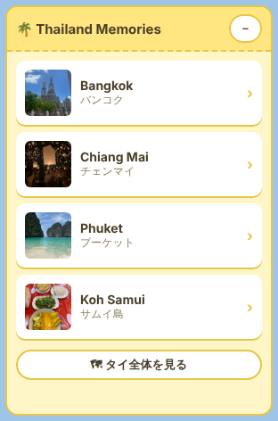
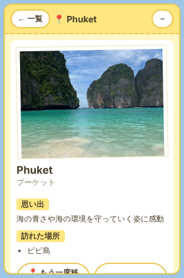

# Hackathon_Oct_KanokoFujiwara

# 🌴 Thailand Memories — Re Visualizer Plugin

タイ旅行の思い出を **写真と地図で振り返る** ための、[Re Visualizer](https://reearth.io/) 用ウィジェットプラグインです。

- 紹介ページ（GitHub Pages）：`https://<GitHubユーザー名>.github.io/Hackathon_Oct_KanokoFujiwara/` ※公開後に書き換え
- 公開済み Re プロジェクト：**（準備中・URL 未確定）**

<p>
  
  
</p>

---

## 作品の目的

旅行で訪れた場所を、地図と写真を組み合わせて **アルバムのように振り返る** ことが目的です。
スポットを選ぶと地図がその場所へ移動し、写真と思い出の文章が表示されます。
大学のゼミ課題として、Claude Code による開発・GitHub でのソース管理・GitHub Pages での公開を行いました。

## 使用技術

- Re Visualizer Plugin API（`reearth.ui.show` / `reearth.ui.resize` / `reearth.extension.on("message")` / `reearth.camera.flyTo`）
- JavaScript（ECMAScript 2020 互換）
- HTML / CSS（JavaScript ファイル内に記述）
- GitHub / GitHub Pages
- 開発支援：Claude Code

## 機能

| 機能 | 内容 |
| --- | --- |
| ① スポット一覧 | バンコク・チェンマイ・プーケット・サムイ島を一覧表示 |
| ② 思い出カード | 場所の名前・写真・思い出の説明文・訪れた場所を表示。写真が未登録でもプレースホルダーを表示 |
| ③ 地図との連動 | 一覧をクリックすると `reearth.camera.flyTo` でその地点へカメラが移動。「タイ全体を見る」ボタンもあり |
| ④ デザイン | パステルイエロー × 白の旅行アルバム風。幅 300px のコンパクト設計、「－」ボタンでたたむことも可能 |
| ⑤ 拡張性 | スポットは `thailand-widget.js` 冒頭の `SPOTS` に 1 か所でまとめて定義 |

## ファイル構成

| ファイル | 役割 | ZIP に入れる？ |
| --- | --- | --- |
| `reearth.yml` | プラグインの設定（ID・名前・拡張ID `thailand-widget`・表示位置） | ✅ |
| `thailand-widget.js` | ウィジェット本体。データ定義・HTML・CSS・動作をすべて含む | ✅ |
| `README.md` | この説明書 | — |
| `ZIP_GUIDE.md` | ZIP の作り方と Re への導入手順 | — |
| `make-zip.sh` | ZIP を自動で作るスクリプト（Mac / Linux） | — |
| `index.html` | GitHub Pages 用の紹介ページ | — |
| `assets/` | 紹介ページ・README 用のスクリーンショット | — |
| `LICENSE` | ライセンス（CC BY 4.0） | — |
| `.gitignore` | Git で管理しないファイルの指定 | — |

## 開発方法

1. このリポジトリをクローン（またはダウンロード）する
2. `thailand-widget.js` をテキストエディタ（VS Code など）で開いて編集する
3. ZIP を作り直して Re にアップロードし、動作を確認する（→ [ZIP_GUIDE.md](ZIP_GUIDE.md)）
4. 変更を GitHub にコミット・プッシュする

ビルド作業やライブラリのインストールは不要です。

### 写真・文章を差し替える

`thailand-widget.js` の先頭にある `SPOTS` を編集します。

```js
{
  id: "bangkok",
  name: "Bangkok",
  nameJa: "バンコク",
  lat: 13.7563,
  lng: 100.5018,
  height: 30000,
  photoUrl: "https://example.com/my-photo.jpg", // ← 写真のURLを入れる
  memory: "ワット・アルンの夕焼けがとてもきれいでした。", // ← 思い出の文章
  places: ["ワット・アルン", "ワット・ポー"],            // ← 訪れた場所
},
```

- `photoUrl` が空（`""`）のとき、または画像が読み込めないときは 📷 のプレースホルダーが表示されます。
- 写真は **インターネット上で公開されている URL（https://〜）** を指定してください。
  たとえばこのリポジトリに画像を置いて GitHub Pages で公開すると、
  `https://<ユーザー名>.github.io/Hackathon_Oct_KanokoFujiwara/photos/bangkok.jpg` のような URL で使えます。
  （ZIP には画像を入れません）

### スポットを追加する

`SPOTS` の `{ ... },` のかたまりを 1 つコピーして、`id`（他と重ならない名前）・名前・緯度経度・文章を書き換えるだけです。
一覧・カード・地図の移動は自動で対応します。

## Re への導入方法

詳しくは **[ZIP_GUIDE.md](ZIP_GUIDE.md)** を見てください。概要：

1. `reearth.yml` と `thailand-widget.js` の 2 つだけを ZIP にする（ZIP のルート直下に置く）
2. プロジェクト設定 → 「プラグイン」→「個人インストール済み」→「PCからZipファイルをアップロード」
3. 地図の編集画面の「ウィジェット」タブ →「ウィジェットを追加」で **Thailand Memories** を追加する

## 使い方

1. 地図の左上に表示される「🌴 Thailand Memories」から、行きたいスポットをクリック
2. 地図がその場所へ移動し、写真付きの思い出カードが表示されます
3. 「📍 もう一度移動」で再びその地点へ、「← 一覧へ」で一覧に戻ります
4. 一覧の「🗺 タイ全体を見る」でタイ全体を表示します
5. 右上の「－」でウィジェットをたたみ、「＋」で開きます（地図を広く見たいとき）

## 動作確認の状況

- ✅ **Re Visualizer（v1.0.0-beta.16.26）の実プロジェクトで動作確認済み**
  - ZIP のインストール、ウィジェットの表示、スポット一覧・思い出カード・写真プレースホルダーの表示
  - 4 つのスポット（Bangkok・Chiang Mai・Phuket・Koh Samui）と「タイ全体を見る」で、地図が正しい場所へ移動すること
- ✅ プラグインプレイグラウンドでも表示とカメラ移動を確認済み
- ⚠️ たたむボタン・スマートフォン表示は、Re 上では未確認
- 使用した API は Re Visualizer 公式リポジトリ（reearth/reearth-visualizer）の型定義・テスト用プラグインと照合しています

## 今後の追加機能（予定）

- 既存の Re スケッチレイヤーをクリックしたときに、対応する思い出カードを表示する連動機能

## ライセンス

[CC BY 4.0（クリエイティブ・コモンズ 表示 4.0 国際）](LICENSE)
作者名（Kanoko Fujiwara）を表示すれば、誰でも利用・改変・再配布できます。
